<!-- _class: lead kick -->
<!-- _paginate: false -->
<!-- _footer: '' -->

GRADUATE COMPUTER SCIENCE · WEB DEVELOPMENT

# Data at Global Scale: Performance, Migrations, Incidents & Recovery

## How production systems store, query, change, break, and recover their data across regions

180-minute lecture · six modules · two breaks  
Running example: Atlas Market (a fictional global marketplace used as a teaching model)  
Case studies from public engineering write-ups and postmortems  

<!--
[~1 min] Welcome. Today is about what happens to data once a web application outgrows a single database in a single region. We follow one storyline: where data lives, how fast we can query it, how we change it safely, how we notice when it breaks, how we recover it (including failing back), and how we learn. Every major idea is anchored in a public case study: problem, pattern, implementation, result.
-->

---

<!-- _class: img -->

# Today's storyline: store → query → change → break → recover → learn

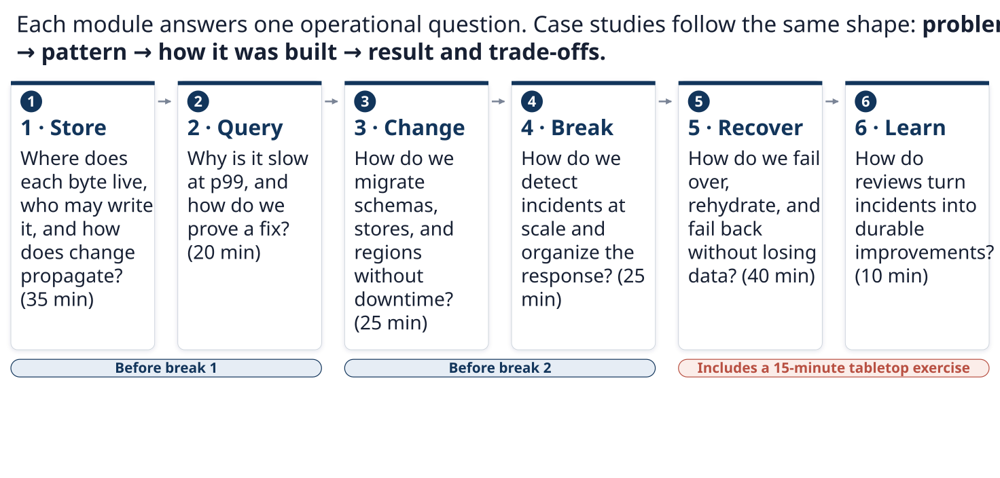

<!--
[~1 min] Timing: roughly 5 minutes of framing, then modules of 35, 20, 25, 25, 40 and 10 minutes, with two 10-minute breaks (after module 2 and after module 4). The DR module is the longest because failing back to the primary is where most teams have the least practice.
-->

---

# By the end of today you should be able to…

1. **Compare** storage and replication options by consistency, write locality, RPO, and rebuild path
2. **Design** change propagation with an outbox, CDC, and idempotent consumers
3. **Diagnose** a slow query with EXPLAIN and reason about tail latency under fan-out
4. **Plan** an online migration with expand/contract, shadow verification, and a rollback path
5. **Detect** incidents with SLO burn-rate alerts and slicing; **run** a response with clear roles
6. **Execute** failover, rehydration of derived data, and a planned failback to the primary
7. **Run** blameless reviews that produce corrective actions people actually finish

<!--
[~1 min] These outcomes map one-to-one to the modules. Ask students to note which one feels least familiar; for most web developers it is failback and rehydration.
-->

---

<!-- _class: img -->

# Atlas Market: the system we will scale, migrate, and break

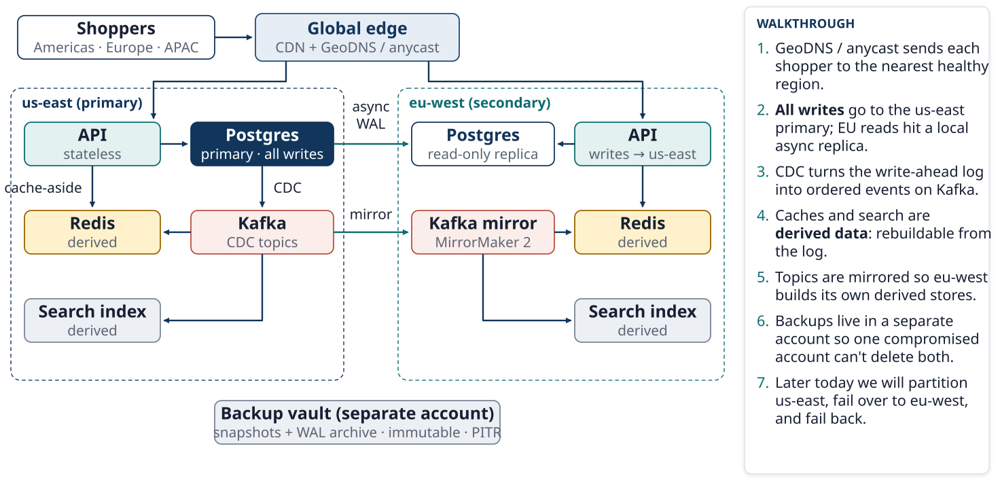

<!--
[~2 min] Atlas Market is fictional: a teaching model that looks like many real marketplaces. Point out the two classes of data: the system of record (Postgres) and derived data (caches, search, analytics). That distinction drives every recovery decision later. The single-writer design is deliberate: it is the most common real-world starting point and the one with the clearest failure modes.
-->

---

<!-- _class: section kick -->

MODULE 1 · 35 MINUTES

# Data at global scale

### Where does each byte live, who is allowed to write it, and how does change reach everyone else?

- Physics sets the latency floor; consistency choices decide who pays it
- Compare storage mechanisms by write model, RPO, and how you rebuild them
- Propagate change through a log, not through dual writes
- Case studies: Facebook memcache, Discord, Shopify, DynamoDB, Spanner

<!--
[~1 min] Module 1 frames everything else. If you choose the wrong write model here, no amount of query tuning or incident process will save you later.
-->

---

# Distance is a latency budget you cannot optimize away

Light in fiber travels about **200 km per millisecond**. A synchronous cross-region write pays at least one round trip.

| Route | Great-circle distance | Floor RTT in fiber | Typical measured RTT | What a synchronous commit feels like |
|---|---|---|---|---|
| Virginia ↔ Oregon | ≈ 3,700 km | ≈ 37 ms | ≈ 60–70 ms | Noticeable on every write; fine for rare admin actions |
| Virginia ↔ Frankfurt | ≈ 6,600 km | ≈ 66 ms | ≈ 85–95 ms | Checkout with 5 sequential writes ≈ half a second |
| Frankfurt ↔ Singapore | ≈ 10,300 km | ≈ 103 ms | ≈ 150–170 ms | Users perceive lag; chatty protocols collapse |
| Virginia ↔ Tokyo | ≈ 10,900 km | ≈ 109 ms | ≈ 145–160 ms | Quorum across three continents ≈ slowest nearest pair |
| Virginia ↔ Sydney | ≈ 15,700 km | ≈ 157 ms | ≈ 195–210 ms | Every lock held across this link blocks for ~0.2 s |

**Takeaway:** Decide **where writes happen** before you pick a database. Measure your own provider's inter-region latency; the right-hand numbers are typical, not guarantees.

<!--
[~2 min] Floor RTT is 2 × distance / 200 km per ms. Real paths are longer than great circles and add routing and queuing, so measured RTTs run 30–60% above the floor. The point: no software optimization removes this cost. You can only avoid paying it on the critical path (async replication, local writes, caching) or pay it deliberately (consensus across regions).
-->

---

<!-- _class: img -->
<!-- _footer: 'Sources: [Spanner (OSDI 2012)](https://research.google/pubs/spanner-googles-globally-distributed-database-2/) · [DynamoDB global tables](https://docs.aws.amazon.com/amazondynamodb/latest/developerguide/V2globaltables_HowItWorks.html)' -->

# CAP describes partitions; PACELC describes every normal day

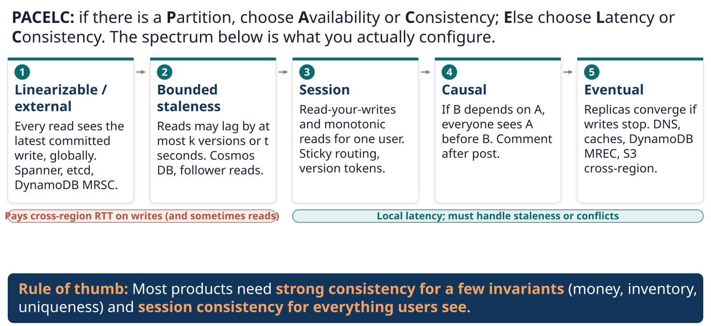

<!--
[~2 min] Spanner achieves external consistency with TrueTime: clock uncertainty is bounded (the paper reports epsilon generally about 1 to 7 ms) and commits wait out that uncertainty (commit wait). DynamoDB global tables default to multi-Region eventual consistency (MREC) with last-writer-wins; multi-Region strong consistency (MRSC) became generally available on June 30, 2025 and gives RPO zero at the cost of write latency. Ask: which Atlas Market data needs which level?
-->

---

<!-- _footer: 'Sources: [Aurora Global Database DR](https://docs.aws.amazon.com/AmazonRDS/latest/AuroraUserGuide/aurora-global-database-disaster-recovery.html) · [DynamoDB global tables](https://docs.aws.amazon.com/amazondynamodb/latest/developerguide/V2globaltables_HowItWorks.html) · [Slack + Vitess](https://slack.engineering/scaling-datastores-at-slack-with-vitess/)' -->

# Comparing primary data stores at global scale

| Option | Consistency & model | Global write model | Cross-region RPO | Fits when… | Watch out for |
|---|---|---|---|---|---|
| Single-primary RDBMS + async replicas (Postgres, MySQL, Aurora Global) | Strong on primary; replicas lag (Aurora: typically < 1 s) | One write region; promote on failover | Seconds on failover; 0 on planned switchover | Most apps; strict invariants (payments, inventory) | Far writers pay RTT; failover loses the lag window |
| Sharded RDBMS (Vitess, Citus, app-level shards) | Strong per shard; cross-shard transactions limited | Each shard has a home region | Per shard, as above | Write volume beyond one machine (Slack, Notion, Figma) | Re-sharding, hot shards, cross-shard queries |
| Distributed SQL (Spanner, CockroachDB, YugabyteDB) | Serializable / external consistency via Paxos or Raft | Writes commit on a cross-region quorum | 0 within the quorum | Global invariants with SQL and automatic failover | Every write pays quorum RTT; locality design is required |
| Wide-column / Dynamo-style (Cassandra, ScyllaDB, DynamoDB global tables) | Tunable or eventual; LWW conflicts (DynamoDB MREC) | Active-active multi-region | ≈ seconds (async); 0 with DynamoDB MRSC | Huge write volume, key-value access, availability first | Conflicts, tombstones, no ad-hoc joins |
| Document (MongoDB replica sets, zone sharding) | Primary per shard; majority write concern | Zones pin shards to regions | Seconds; majority writes reduce loss | Flexible schema; per-tenant data locality | Default write concerns; rollback after elections |

<!--
[~4 min] Read the table by column, not by row. The write model and RPO columns determine your disaster recovery story. Aurora Global Database documents two operations: switchover (planned, RPO zero, used to fail back) and failover (unplanned, RPO typically seconds, RTO in minutes). Slack moved to Vitess starting in 2017; by 2020 it served 99% of query load at 2.3M peak QPS. The choice is rarely one store: most systems combine a single-primary or sharded RDBMS for invariants with eventually consistent stores for scale.
-->

---

<!-- _class: dense -->
<!-- _footer: 'Sources: [S3 Replication Time Control](https://docs.aws.amazon.com/AmazonS3/latest/userguide/replication-time-control.html) · [S3 strong consistency (2020)](https://aws.amazon.com/blogs/aws/amazon-s3-update-strong-read-after-write-consistency/) · [Cloudflare Workers KV](https://developers.cloudflare.com/kv/concepts/how-kv-works/)' -->

# Supporting stores: how they replicate and how you rebuild them

| Store | Role | How it propagates globally | Consistency | Rehydration source after an outage |
|---|---|---|---|---|
| Cache (Redis, Memcached) | Latency, load shield | Usually per region; invalidated from CDC, not replicated | Stale by design | Warm gradually from the DB; never trust a cache snapshot from the failed side |
| Object storage (S3, GCS, Blob) | Blobs, backups, lake | Cross-region replication; S3 RTC SLA: 99.9% of objects in 15 min | Strong in-region (S3 since Dec 2020); async cross-region | Versioned buckets; inventory diff; batch replication |
| Search index (OpenSearch, Elasticsearch) | Text search, facets | Cross-cluster replication, or each region indexes from the stream | Eventual | Replay CDC from an offset, or reindex into a new index and swap the alias |
| Event log (Kafka, Kinesis, Pub/Sub) | Propagation backbone | MirrorMaker 2 / cluster linking; retention window | Ordered per partition | Replay retained offsets; translate consumer offsets across clusters |
| Analytics (warehouse, lakehouse) | Reporting, ML | Batch or streaming from CDC | Minutes to hours | Recompute affected partitions from the log or lake snapshots |
| Edge KV / CDN | Static assets, edge config | Push or pull to points of presence | Eventual (Workers KV: up to ~60 s) | Purge, then refill from origin; config from source control |

**Design rule:** Classify every store as **system of record** or **derived**. Derived data must be rebuildable from the record, and you should have timed how long that takes.

<!--
[~3 min] The last column is the one teams skip. Note the S3 nuance: the contractual Replication Time Control SLA is 99.9% of objects within 15 minutes; AWS marketing also cites a typical 99.99% figure, but do not confuse the two. S3 became strongly consistent for GET, PUT and LIST in December 2020 with no app changes. Workers KV is eventually consistent; changes can take up to about 60 seconds to be visible elsewhere.
-->

---

# Choose a store with questions, not brand names

- **1 · What invariant can never break?** — No oversell, no double charge, unique usernames → single writer or consensus for that data.
- **2 · What is the access pattern?** — Key lookups and range scans scale out easily; ad-hoc joins and aggregates want SQL or a warehouse.
- **3 · Where are users and laws?** — Latency budgets and residency (GDPR, data localization) decide home regions.
- **4 · How fast does it grow?** — Pick a partition key that spreads writes and keeps a tenant together (workspace, shop, channel).
- **5 · What RPO / RTO per data class?** — Orders: seconds of loss unacceptable. Recommendations: rebuild tomorrow is fine.
- **6 · How is it rebuilt?** — Name the source of truth and the replay path. Time it in a drill, not during an outage.

**Applied:** Atlas Market: orders and inventory → single-primary Postgres; sessions → regional KV; catalog search → derived index; images → replicated object storage.

<!--
[~2 min] Walk through the six questions using Atlas Market. Emphasize question six: the rebuild path is a design artifact, just like the schema.
-->

---

<!-- _class: img -->
<!-- _footer: 'Sources: [Dynamo (SOSP 2007)](https://www.allthingsdistributed.com/files/amazon-dynamo-sosp2007.pdf) · [Spanner (OSDI 2012)](https://research.google/pubs/spanner-googles-globally-distributed-database-2/)' -->

# Four replication topologies: who must agree before a write is done?

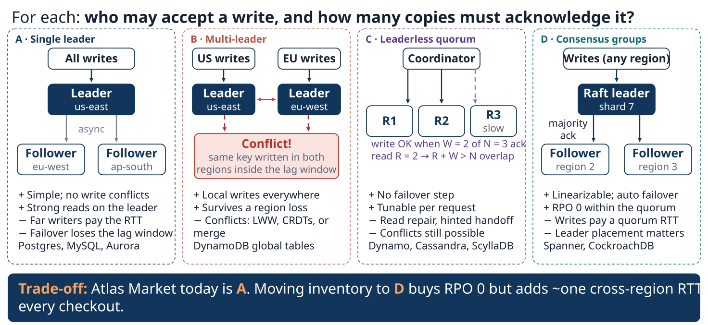

<!--
[~4 min] A: one writer, followers ship the log asynchronously. B: two writers, so the same key can be written in both regions within the replication lag; you must resolve conflicts. C: no leader; the client or a coordinator writes to N replicas and waits for W acks; reads ask R replicas; if R + W > N, read and write sets overlap. D: each shard is a Raft or Paxos group; a write commits when a majority acks, so losing a minority loses nothing, but each write waits for the nearest majority.
-->

---

<!-- _footer: 'Sources: [Dynamo (SOSP 2007)](https://www.allthingsdistributed.com/files/amazon-dynamo-sosp2007.pdf) · [DynamoDB global tables](https://docs.aws.amazon.com/amazondynamodb/latest/developerguide/V2globaltables_HowItWorks.html)' -->

# If two regions accept writes, you need a conflict strategy

- **Last writer wins (LWW)** — Highest timestamp survives; the other write silently disappears; Default for DynamoDB global tables (MREC); Fine for profile fields; dangerous for counters and money
- **CRDTs (conflict-free replicated data types)** — Data types whose merges commute: counters, sets, registers; Redis Enterprise Active-Active, Riak, Automerge; Great for likes and carts; can't express “stock ≥ 0”
- **Application merge** — Store siblings; the app merges them on read; Amazon's Dynamo shopping cart: union of versions, so deleted items could reappear; Correct but pushes complexity into every reader
- **Avoid conflicts by routing** — Give every key a home region; only the home accepts writes; Global tables for reads, single writer per tenant or key; What most large SaaS products actually do

**Key point:** Invariants that span keys (inventory ≥ 0, unique email) need a **single writer or consensus**; no merge function can fix an oversell after the fact.

<!--
[~3 min] The Dynamo paper's shopping cart is the classic example: merging divergent carts by union never loses an added item, but deleted items can resurface. That was an acceptable business trade-off for a cart, not for a payment. DynamoDB documentation states that with MREC, conflicts are resolved with last writer wins.
-->

---

<!-- _class: dense -->
<!-- _footer: 'Sources: [Scaling Memcache at Facebook (NSDI 2013)](https://www.usenix.org/system/files/conference/nsdi13/nsdi13-final170.pdf)' -->

# Facebook memcache: consistent caches across regions

**Problem:** Facebook served reads from memcache clusters in several regions in front of MySQL. Writes went to a master region; caches elsewhere could serve stale data, and users might not see their own writes.

**Pattern:** **Invalidate from the commit log, not from application code.** Pair that with leases to stop stampedes and remote markers for read-your-writes.

**How they did it:**
1. Writes commit to MySQL in the master region; replication carries them to replica regions.
2. **mcsqueal** daemons tail the MySQL commit log, extract keys to delete, and batch deletes to memcache routers.
3. In replica regions, invalidations are driven by the local replication stream, so a cache is cleared only after the data has arrived.
4. **Remote markers**: after a user writes from a replica region, reads of that key go to the master region until replication catches up.
5. **Leases**: on a miss, only one client gets a token to refill; others wait or take slightly stale data.
6. **Cold cluster warmup**: a new cluster reads from a warm cluster instead of hammering the database.

> **Result:** Leases cut the peak database query rate from **17K/s to 1.3K/s**; cold clusters warmed in a few hours instead of a few days.
>
> **Lesson:** Derive invalidation from the log of record. Treat cache warm-up as a first-class recovery step.

<!--
[~4 min] Why the commit log? If the application deletes cache keys after writing, any crash between the two steps leaves stale data forever. The commit log is complete and ordered. Ordering across regions is the subtle part: invalidating a replica region's cache before replication arrives lets a reader refill it with old data. Remember 'cold cluster warmup'; we return to it in the recovery module.
-->

---

<!-- _class: img -->
<!-- _footer: 'Sources: [Debezium outbox router](https://debezium.io/documentation/reference/stable/transformations/outbox-event-router.html) · [Netflix DBLog (arXiv)](https://arxiv.org/abs/2010.12597)' -->

# Propagate change with an outbox, CDC, and a replayable log

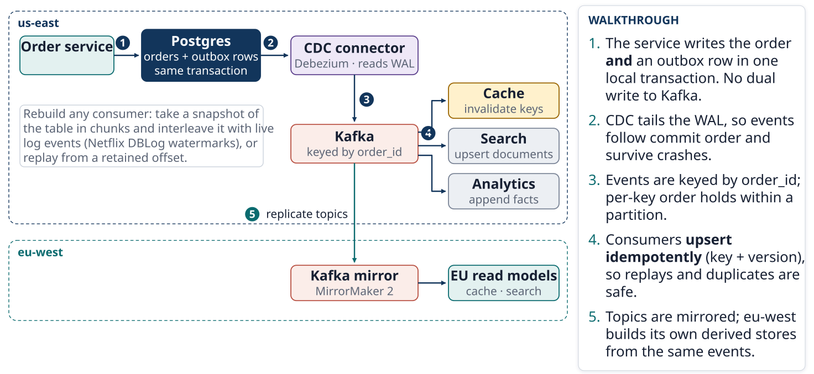

<!--
[~4 min] The anti-pattern this replaces is the dual write: commit to the DB, then publish to Kafka. If the process dies in between, the two diverge silently. With the outbox, the event is part of the same transaction as the business change. This log is also the rehydration backbone: if a search cluster is lost or diverges after a failover, you rebuild it from the log rather than restoring it from its own backup.
-->

---

<!-- _class: img -->
<!-- _footer: 'Sources: [Shopify pods](https://shopify.engineering/a-pods-architecture-to-allow-shopify-to-scale) · [Shopify shard balancing](https://shopify.engineering/mysql-database-shard-balancing-terabyte-scale)' -->

# Give every record a home: cells and home regions

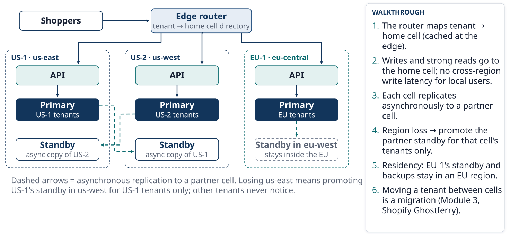

<!--
[~3 min] Cells bound blast radius: an incident in one cell affects only its tenants. Shopify's pods follow this idea: each pod holds a set of shops with its own datastores, and a routing layer sends each request to the right pod. The cost is that cross-tenant features (global search, marketplace-wide analytics) need a derived global view, again built from the log.
-->

---

# Atlas Market expands to the EU

> **Scenario:** Atlas Market signs EU merchants. EU law and contracts require EU customer data to stay in the EU. Checkout must never oversell inventory. The catalog is read 500× more than it is written. The CTO asks: “Can't we just turn on multi-region writes?”

1. Which data classes need a single writer or consensus, and which can be eventually consistent?
2. Where does an EU merchant's inventory counter live, and what does a US shopper's checkout pay in latency?
3. For each derived store, what is the system of record and how would you rebuild it?
4. What would you say to the CTO in one sentence?

**Hints:** Separate tenants (merchants) from shoppers · Home-cell routing per merchant · Catalog → derived search per region · Payments: the PSP is an external system of record

<!--
[~3 min] Good answers: inventory and orders are homed with the merchant (EU cell for EU merchants); a US shopper buying from an EU merchant pays one transatlantic RTT at checkout, which is acceptable. Catalog and search are derived per region. Sessions are regional. One-sentence answer: multi-region writes don't remove the need for a single owner of inventory; they just hide the conflict until it's an oversell.
-->

---

<!-- _class: section kick -->

MODULE 2 · 20 MINUTES

# Query performance at scale

### Why is it fast on my laptop and slow at p99 in production, and how do we prove a fix?

- Latency is a sum, and fan-out turns rare slowness into common slowness
- A repeatable loop: measure → find → explain → fix → verify
- Pagination, caching, and request coalescing patterns
- Case study: Discord's data services in front of ScyllaDB

<!--
[~1 min] Module 2 is practical. Students should leave with a workflow they can run on Monday.
-->

---

# What changes when data and traffic grow 100×

- **Plans flip** — The optimizer picks a different plan when a table crosses a size or statistics threshold. Yesterday's index scan becomes a sequential scan.
- **N + 1 queries** — An ORM loop issues one query per row. 20 ms locally becomes 2 s when the DB is 1 ms away and there are 500 rows.
- **Hot keys and partitions** — A celebrity account, a popular product, or a busy channel concentrates load on one shard or cache node.
- **Lock contention** — Counters, inventory rows, and long transactions serialize writers; latency grows with concurrency, not data size.
- **Cache-miss storms** — A deploy, an eviction, or a failover empties caches; every miss becomes a database query at once.
- **Hidden round trips** — A call that crosses regions adds 70–150 ms. Several in sequence turn a fast page into a slow one.

**Principle:** Measure **percentiles per endpoint and per query**, not averages. The mean hides the users who are leaving.

<!--
[~2 min] Ask students which of these they have seen. The N+1 example is worth doing on the board: 500 rows × 1 ms network RTT = 500 ms before any query work. Plan flips are the scariest because nothing in your code changed.
-->

---

<!-- _class: img -->
<!-- _footer: 'Sources: [PostgreSQL pg_stat_statements](https://www.postgresql.org/docs/current/pgstatstatements.html) · [PostgreSQL EXPLAIN](https://www.postgresql.org/docs/current/using-explain.html)' -->

# A repeatable loop for slow queries

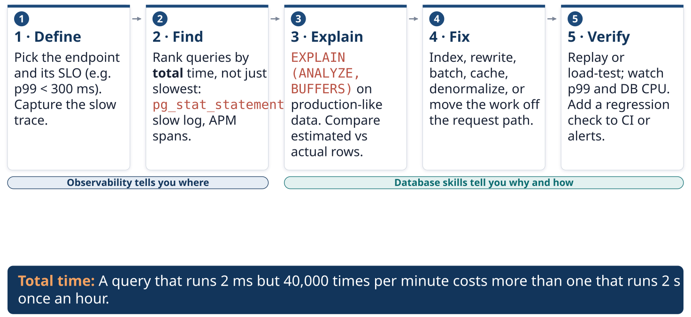

<!--
[~2 min] Step 2 is where most teams go wrong: they optimize the scariest-looking query instead of the one consuming the most total database time. pg_stat_statements exposes total_exec_time and calls. In step 3, a large gap between estimated and actual rows usually means stale statistics or correlated columns.
-->

---

<!-- _class: img -->
<!-- _footer: 'Sources: [PostgreSQL EXPLAIN](https://www.postgresql.org/docs/current/using-explain.html) · [CREATE INDEX CONCURRENTLY](https://www.postgresql.org/docs/current/sql-createindex.html#SQL-CREATEINDEX-CONCURRENTLY)' -->

# Reading EXPLAIN: the order-history query

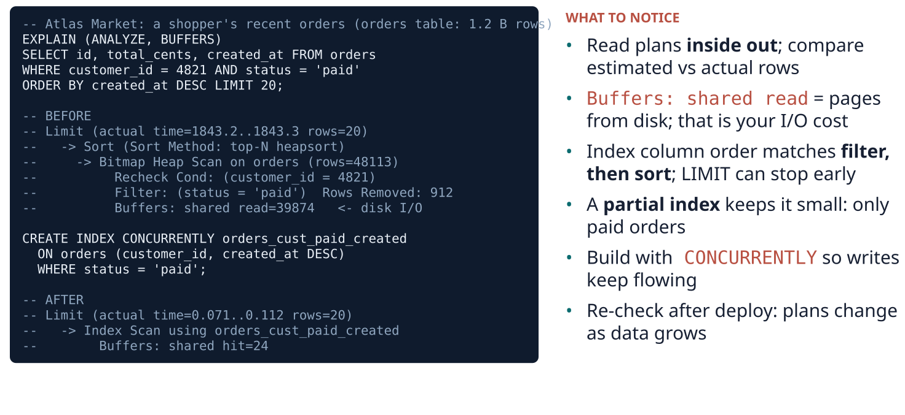

<!--
[~3 min] Illustrative numbers in the shape of real Postgres output. The before plan fetches all 48K orders for a heavy customer, filters, then sorts to keep 20. The composite partial index returns rows already in created_at order, so the LIMIT stops after 20 index entries. That is the difference between 40K pages read from disk and 24 pages from memory.
-->

---

<!-- _footer: 'Sources: [Slack: Evolving API pagination](https://slack.engineering/evolving-api-pagination-at-slack/) · [Use The Index, Luke: no offset](https://use-the-index-luke.com/no-offset)' -->

# OFFSET pagination degrades linearly; keyset stays flat

| OFFSET / LIMIT | Keyset (cursor) pagination |
|---|---|
| `ORDER BY created_at DESC LIMIT 50 OFFSET 100000` | `WHERE (created_at, id) < ($last_ts, $last_id) ORDER BY created_at DESC, id DESC LIMIT 50` |
| The database reads and discards 100,000 rows to return 50 | Uses an index seek: page 2,000 costs the same as page 1 |
| Deep pages get slower as the table grows; crawlers find them | Stable under inserts; the cursor is an opaque token for clients |
| Concurrent inserts shift pages: users see duplicates or gaps | Needs a unique, indexed sort key (tie-break on `id`) |
| Fine for small admin tables and page-number UIs | Slack moved its APIs to cursor-based pagination for this reason |

**API design:** Expose an **opaque cursor** in your API (base64 of the last key) so you can change the implementation later.

<!--
[~3 min] Keyset pagination is one of the cheapest large wins in web backends. The row-value comparison (created_at, id) < (…) matches a composite index on (created_at DESC, id DESC). Slack's engineering post explains why they moved from offset and page-number pagination to cursors across their API.
-->

---

<!-- _class: dense -->
<!-- _footer: 'Sources: [Discord: storing trillions of messages](https://discord.com/blog/how-discord-stores-trillions-of-messages)' -->

# Discord: hot partitions and request coalescing

**Problem:** Messages lived in Cassandra (177 nodes). A busy channel concentrated reads on one partition; hot partitions, garbage-collection pauses, and compaction backlogs drove unpredictable latency and on-call toil.

**Pattern:** **Data services with request coalescing** between the API and the database, plus a move to ScyllaDB (no JVM garbage collector).

**How they did it:**
1. Built Rust “data services”: one gRPC endpoint per query type, in front of the database.
2. **Request coalescing**: if many users request the same channel's messages at once, only one DB query runs; all waiters share its result.
3. **Consistent-hash routing** by channel_id sends requests for a channel to the same service instance, so coalescing actually happens.
4. Wrote a Rust migrator that copied messages at up to **3.2M rows/s**; the migration took about 9 days.
5. It stalled at 99.9999% on huge tombstone ranges that had never been compacted; they compacted and resumed.
6. Cut over from 177 Cassandra nodes to **72 ScyllaDB** nodes.

> **Result:** p99 for historical message reads fell from **40–125 ms to 15 ms**; p99 inserts from **5–70 ms to a steady 5 ms**.
>
> **Lesson:** Protect the database from duplicate work before you buy a bigger database. Old data hides migration surprises.

<!--
[~3 min] This case belongs in both the performance and the migration modules. Coalescing works only if identical requests reach the same process, hence consistent hashing. The 99.9999% stall is a perfect example of why migrations need verification and time buffers: the last 0.0001% contained the pathological data.
-->

---

<!-- _footer: 'Sources: [Scaling Memcache at Facebook](https://www.usenix.org/system/files/conference/nsdi13/nsdi13-final170.pdf)' -->

# Cache failure modes you will meet at scale

- **Stampede (thundering herd)** — A hot key expires; thousands of misses hit the DB; Fix: leases or single-flight, early refresh, jittered TTLs
- **Hot key** — One key exceeds one cache node's capacity; Fix: in-process cache, key replication or splitting
- **Penetration** — Lookups for keys that don't exist always miss; Fix: negative caching, Bloom filters, input validation
- **Stale or inconsistent data** — App writes DB then deletes cache; a crash in between leaves stale data; Fix: invalidate from CDC, versioned keys, short TTLs
- **Cold cache after failover** — New region starts with empty caches; DB melts; Fix: pre-warm, shift traffic gradually, shed load
- **Cache as hidden dependency** — The DB can no longer serve 100% of reads without the cache; Fix: capacity-plan for the miss rate you would see during recovery

<!--
[~3 min] The bottom row matters for disaster recovery: a cache that hides 95% of reads means your database is sized for 5% of real traffic. After a failover, that 95% arrives at the database at once. Keep this in mind for Module 5.
-->

---

<!-- _class: img -->
<!-- _footer: 'Sources: [The Tail at Scale (CACM 2013)](https://research.google/pubs/the-tail-at-scale/)' -->

# Fan-out turns a rare slow server into a common slow page

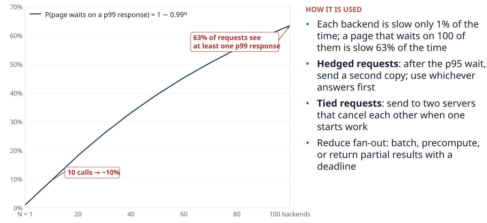

<!--
[~2 min] Dean and Barroso's paper gives this exact example: if each server has a 1-in-100 chance of a slow response, a request that fans out to 100 servers is slow 63% of the time. Hedging costs only a few percent extra load because you only hedge the slowest requests.
-->

---

# Query anti-patterns and their fixes

| Anti-pattern | Symptom at scale | Fix |
|---|---|---|
| N + 1 queries from an ORM loop | Latency grows with result size; many identical queries per request | Eager loading, `IN (…)` batches, DataLoader-style batching |
| `SELECT *` on wide rows | Network and memory spikes; covering indexes unusable | Select needed columns; covering indexes |
| Functions on indexed columns (`WHERE lower(email) = …`) | Sequential scans | Expression index or normalized column |
| Unbounded queries (no LIMIT, no time window) | Fine until one tenant gets big | Pagination, max page size, query timeouts |
| Long transactions around remote calls | Lock waits, replica lag, vacuum stalls | Keep transactions short; call out after commit (outbox) |
| Read-after-write against a lagging replica | “My change disappeared” bug reports | Session tokens / LSN waits, or read the primary briefly |
| Counting with `COUNT(*)` on huge tables | Seconds per page view | Approximate counts, counters maintained from CDC |

<!--
[~1 min] Use this as a handout-style checklist. Students can apply it in code review.
-->

---

<!-- _class: section kick -->

BREAK · 10 MINUTES

# Break

### Next: changing schemas, stores, and regions while the system stays online.

- Think about it: what is the riskiest migration you have seen or done?
- What made it reversible, or not?

<!--
[~10 min] Ten-minute break. Restart on time; Module 3 builds directly on the CDC ideas from Module 1.
-->

---

<!-- _class: section kick -->

MODULE 3 · 25 MINUTES

# Migrations without downtime

### How do we change the shape or location of data while users keep reading and writing it?

- Every migration is a sequence of individually reversible steps
- Dual write or CDC, backfill, verify, switch reads, then contract
- Online schema change tools: gh-ost, CONCURRENTLY, NOT VALID
- Case studies: Stripe, Notion, GitHub MySQL 8, Shopify Ghostferry

<!--
[~1 min] The theme is reversibility. A migration plan should say, for every step, how to go back.
-->

---

# Six kinds of migration, from easy to hard

| Kind | Example | Main risk | Core technique |
|---|---|---|---|
| Additive schema change | Add a nullable column or a new table | Locks on hot tables | Short lock timeouts; online DDL |
| Destructive schema change | Rename or drop a column; change a type | Old code still reads the old shape | Expand / contract across several deploys |
| Data backfill | Populate a new column for 2 B rows | Replica lag, I/O saturation, long locks | Batched, throttled, resumable jobs |
| Engine or version upgrade | MySQL 5.7 → 8.0; Postgres 13 → 16 | Planner and behavior changes | Replicas on the new version; canary reads; backward replication |
| Store change | Cassandra → ScyllaDB; Mongo → Postgres | Semantic mismatch; long copy | Dual write or CDC, backfill, shadow reads, cutover |
| Re-partition or move region | Split 32 shards into 96; move a tenant to the EU | Write loss at cutover; routing errors | Copy + tail the log, brief write freeze, routing flip |

<!--
[~2 min] The bottom three rows share a common skeleton, which the next slides cover: copy the existing data, keep it in sync with ongoing changes, verify, then switch.
-->

---

<!-- _class: img -->

# Expand / contract: change shape in reversible steps

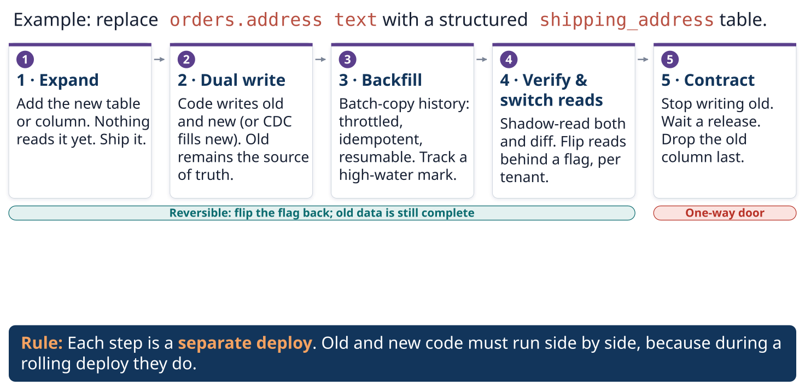

<!--
[~3 min] Expand/contract is also called parallel change. The crucial point: at every step before contract, the old representation is complete and authoritative, so rollback is a configuration change, not a data repair. Mention that mobile clients may run old versions for months, which can extend step 4.
-->

---

<!-- _class: img -->
<!-- _footer: 'Sources: [github/gh-ost](https://github.com/github/gh-ost)' -->

# How gh-ost alters a billion-row MySQL table online

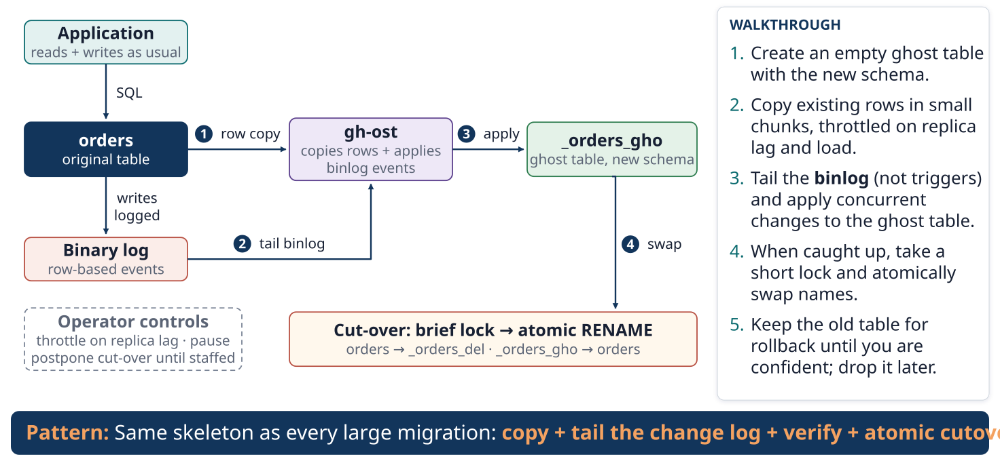

<!--
[~3 min] gh-ost is GitHub's triggerless online schema migration tool for MySQL. Older tools (pt-online-schema-change) used triggers, which add write load and locking on the hot table. Because gh-ost reads the binlog as a replica would, it can pause, throttle, and even postpone the cut-over until an engineer is present. Tie this back to Module 1: it is CDC applied to a schema change.
-->

---

<!-- _class: img -->
<!-- _footer: 'Sources: [PostgreSQL ALTER TABLE](https://www.postgresql.org/docs/current/sql-altertable.html) · [PostgreSQL explicit locking](https://www.postgresql.org/docs/current/explicit-locking.html)' -->

# Safe online DDL in PostgreSQL

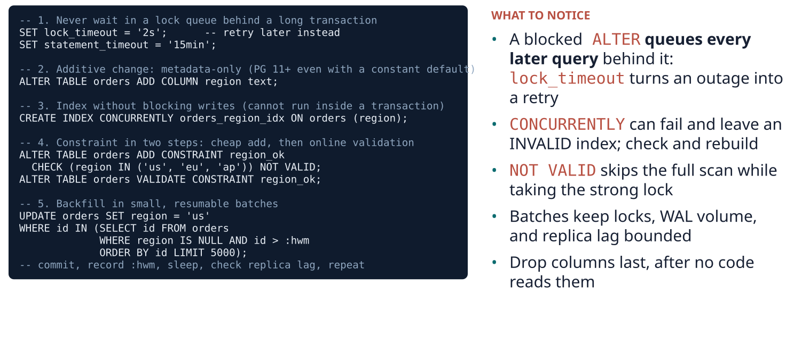

<!--
[~3 min] The lock-queue problem is the most common self-inflicted Postgres outage: ALTER TABLE waits for an ACCESS EXCLUSIVE lock behind a long-running SELECT, and every new query queues behind the ALTER. lock_timeout makes the migration fail fast instead. Since PostgreSQL 11, adding a column with a constant default no longer rewrites the table.
-->

---

<!-- _class: dense -->
<!-- _footer: 'Sources: [Stripe: Online migrations at scale](https://stripe.com/blog/online-migrations)' -->

# Stripe: moving live payment data with dual writes

**Problem:** Stripe needed to change how core objects such as subscriptions were stored, moving them to a new data model while every object stayed live and payment correctness was non-negotiable.

**Pattern:** **Four-phase dual-write migration** with offline backfill and side-by-side comparison of old and new code paths.

**How they did it:**
1. **Dual write**: every write goes to both the old and the new store; reads still come from the old one.
2. **Backfill**: an offline batch job (Hadoop / MapReduce) copies historical objects into the new store.
3. **Change reads**: compare old and new read paths with GitHub's **Scientist** library, then flip reads to the new store.
4. **Change writes**: write only to the new store; the old path becomes read-only.
5. Finally remove old code and data once nothing depends on it.

> **Result:** The migration completed online with **no downtime**; discrepancies were found by comparison before customers saw them.
>
> **Lesson:** Make the new path prove itself against the old one on real traffic before it becomes the source of truth.

<!--
[~3 min] Scientist runs both code paths, returns the old result, and records mismatches. That is the 'shadow read' or 'dark read' pattern. Ask: what is the rollback plan at each phase? Before step 4 it is a flag flip; after it you would need to dual-write in reverse.
-->

---

<!-- _class: dense -->
<!-- _footer: 'Sources: [Notion: Sharding Postgres](https://www.notion.com/blog/sharding-postgres-at-notion) · [Notion: The great re-shard](https://www.notion.com/blog/the-great-re-shard)' -->

# Notion: sharding Postgres, then re-sharding it

**Problem:** Notion ran on a single Postgres primary. Its block table, which holds every piece of content, outgrew one machine: vacuum stalls and the risk of transaction ID wraparound became existential threats.

**Pattern:** **Application-level sharding by workspace**: 480 logical shards on 32 physical hosts. In 2023 they grew to 96 hosts by moving logical shards.

**How they did it:**
1. 2021: partition key = workspace ID, so a page and its blocks live on one shard (no cross-shard joins).
2. Double-write new changes through an **audit log**; a catch-up script replays it into the shards.
3. Backfill history on a 96-vCPU machine in about **three days**.
4. **Dark reads**: query both old and new and compare results before switching.
5. 2023: logical replication copies logical shards to new hosts; pgbouncer routing flips per shard.
6. Schedule cutovers at low traffic with a brief, rehearsed write pause.

> **Result:** Growing from 32 to 96 hosts **without remodeling data** restored large CPU and IOPS headroom; cutovers were short and rehearsed.
>
> **Lesson:** Many **logical** shards on few **physical** hosts make future moves a routing change, not a data remodel.

<!--
[~3 min] The logical-versus-physical distinction is the key design lesson. Because Notion created 480 logical shards up front (divisible by many host counts), going from 32 to 96 hosts meant relocating whole logical shards with Postgres logical replication, not re-hashing rows. Figma made a similar choice: logical sharding (views and routing in DBProxy) before physical splits.
-->

---

<!-- _footer: 'Sources: [GitHub: Upgrading GitHub.com to MySQL 8.0](https://github.blog/engineering/infrastructure/upgrading-github-com-to-mysql-8-0/)' -->

# GitHub: upgrading 1,200 MySQL hosts to version 8.0

**Problem:** GitHub.com ran on 1,200+ MySQL 5.7 hosts (300+ TB, 5.5M queries per second). 5.7 was reaching end of life, and a major-version upgrade can change query plans and behavior across thousands of queries.

**Pattern:** **Incremental upgrade with a rollback path kept open**: new-version replicas first, then primaries, with **backward replication** from 8.0 to 5.7.

**How they did it:**
1. Upgrade replicas cluster by cluster; shift a slice of read traffic and watch latency and errors.
2. Promote an 8.0 replica to primary, keeping 5.7 replicas fed from it (8.0 → 5.7 replication).
3. Because 5.7 replicas stayed current, a rollback was just another failover back to 5.7.
4. Fix incompatibilities found along the way, such as character-set and collation defaults.
5. Proceed cluster by cluster, so each step has a small blast radius.

> **Result:** GitHub.com reached MySQL 8.0 while staying online, with a **working rollback path at every step**.
>
> **Lesson:** A migration is only as safe as its rollback. Keep the old version **current**, not just available.

<!--
[~2 min] Backward replication is unusual: MySQL officially supports replicating from older to newer versions. GitHub configured 8.0 primaries to replicate to 5.7 replicas, which required care with collation and other settings. Compare to failback in Module 5: same idea of keeping the old side in sync so you can go back.
-->

---

<!-- _class: img -->
<!-- _footer: 'Sources: [Shopify: shard balancing](https://shopify.engineering/mysql-database-shard-balancing-terabyte-scale) · [Shopify/ghostferry](https://github.com/Shopify/ghostferry)' -->

# Shopify Ghostferry: move a shop between shards or regions

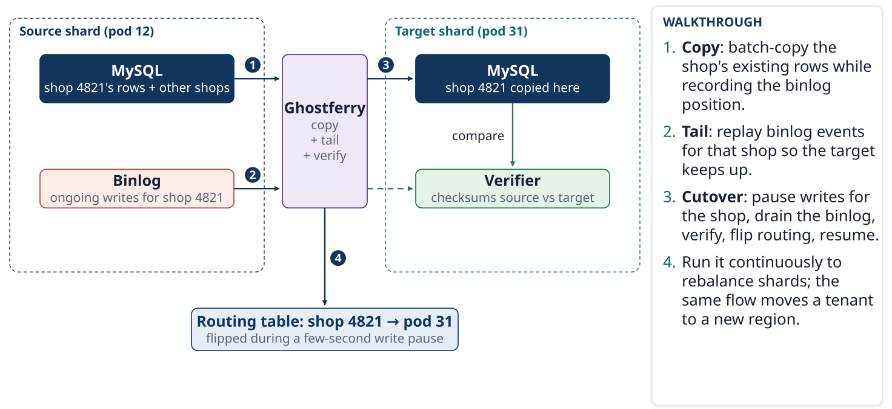

<!--
[~3 min] Shopify describes three phases: batch copying with binlog tailing, cutover, and cleanup. The write pause is per shop and lasts seconds, so most merchants never notice. This is the same pattern as gh-ost, applied to a subset of rows instead of a whole table, and the same pattern you would use to move an EU merchant into an EU cell for residency.
-->

---

# Verification and rollback: how you know you can go back

- **Counts & checksums** — Per-chunk row counts and hashes on both sides. Cheap, continuous, resumable.
- **Shadow / dark reads** — Serve from old, also read new, log diffs (Scientist, Notion dark reads).
- **Canary by tenant** — Flip internal accounts first, then 1%, then 10%. Keep a per-tenant flag.
- **Kill switch** — One config flag returns reads (and writes) to the old path within seconds.
- **Reverse sync** — Keep the old store current after cutover (GitHub 8.0 → 5.7, reverse CDC).
- **Name the one-way door** — Write down the step after which rollback means data repair, and get sign-off.

**Checklist:** Every step answers: **How do we detect a problem? How fast can we go back? What data could be lost?**

<!--
[~2 min] These six tools reappear in the failback discussion in Module 5. A failback is a migration back to the primary, and deserves the same rigor.
-->

---

<!-- _class: section kick -->

MODULE 4 · 25 MINUTES

# Incidents at scale

### How do we notice that users are hurting, find where, and organize people to stop the bleeding?

- Alert on user-visible symptoms and SLO burn, not on every cause
- Slice by region, cell, and version to find the blast radius fast
- Incident command: clear roles, a cadence, and mitigation before diagnosis
- Case studies: Cloudflare 2019, Facebook 2021, Azure 2018, GitHub 2018

<!--
[~1 min] Module 4 shifts from design-time decisions to run-time decisions under pressure.
-->

---

<!-- _footer: 'Sources: [Google SRE book: Introduction](https://sre.google/sre-book/introduction/)' -->

# At scale, something is always a little broken

- **Changes cause most outages.** Google SRE reports roughly **70%** of outages come from changes to a live system: deploys, config, flags, migrations
- **Partial and gray failures** dominate
   - One AZ, one cell, one shard, one client version, one ISP: the global average looks healthy
   - A host that is slow but passes health checks can be worse than one that is down
- **Dependencies fail together.** DNS, identity, config, and control planes sit under everything
- **Alert fatigue** trains people to ignore pages; every page must be actionable and urgent
- **Your tools share fate** with production: dashboards, chat, and runbooks can go down with it

> **Design goals for detection** — Detect user pain in **< 5 minutes** Localize it in **< 10 minutes** Correlate with recent changes automatically Keep an out-of-band path: status, chat, paging

<!--
[~2 min] The 70% figure is from the introduction of the Google SRE book. The practical consequence: the first question in any incident is 'what changed?', and your tooling should answer it automatically by overlaying deploys, flag flips, and config pushes on graphs.
-->

---

<!-- _footer: 'Sources: [SRE book: Monitoring distributed systems](https://sre.google/sre-book/monitoring-distributed-systems/) · [Brendan Gregg: USE method](https://www.brendangregg.com/usemethod.html)' -->

# Three lenses: golden signals, RED, and USE

| Four golden signals (Google SRE) | RED (Tom Wilkie) | USE (Brendan Gregg) |
|---|---|---|
| **Latency**: of successful and failed requests | **Rate**: requests per second | **Utilization**: % time busy |
| **Traffic**: requests or business events per second | **Errors**: failed requests per second | **Saturation**: queued work |
| **Errors**: explicit (5xx), implicit (wrong content), policy (too slow) | **Duration**: latency distribution | **Errors**: device or resource errors |
| **Saturation**: how full the most constrained resource is | One standard dashboard per microservice | Apply per resource: CPU, disk, NIC, DB connections, locks |
| Best for user-facing services | Best for request-driven services | Best for finding the bottleneck |

**Principle:** Page on **symptoms** (golden signals, SLOs). Use **causes** (USE metrics) for diagnosis dashboards, not pages.

<!--
[~2 min] These overlap; pick one vocabulary per team. Implicit errors matter at scale: an HTTP 200 with an empty product list is an error to the user. That is why business metrics, next slide, are so powerful.
-->

---

<!-- _class: img -->
<!-- _footer: 'Sources: [Netflix: SPS, the pulse of streaming](https://netflixtechblog.com/sps-the-pulse-of-netflix-streaming-ae4db0e05f8a)' -->

# Detect with a business metric: Netflix-style “pulse”

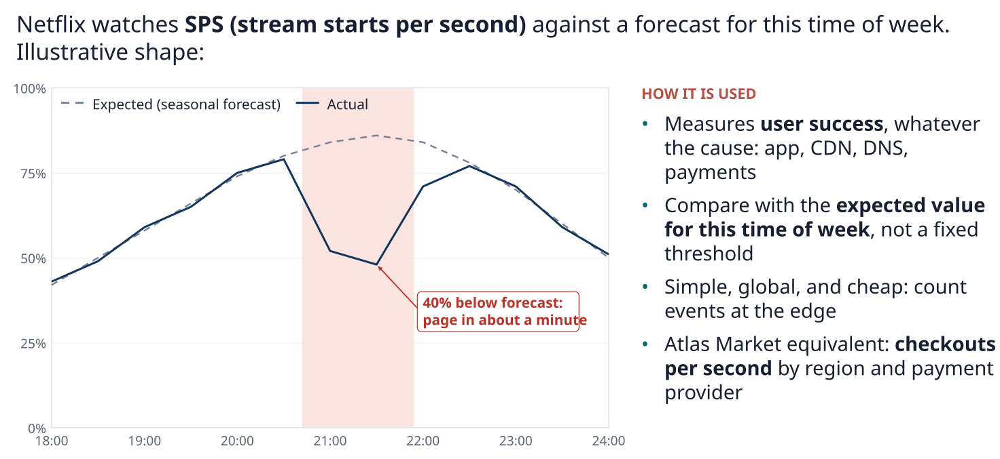

<!--
[~2 min] The numbers here are illustrative, normalized to a weekly peak. Netflix's tech blog describes SPS as its key health metric and alerts when it deviates from a predicted value. For a marketplace, orders per second or successful payment authorizations per second play the same role.
-->

---

<!-- _footer: 'Sources: [SRE workbook: Alerting on SLOs](https://sre.google/workbook/alerting-on-slos/)' -->

# Alert on how fast you are burning the error budget

SLO **99.9%** over 30 days → error budget = 0.1% of requests ≈ **43.2 minutes** of full outage. **Burn rate** = observed error rate ÷ 0.1%; burn rate 1 spends exactly the budget in 30 days.

| Budget consumed | Long window | Short window | Burn rate | Error rate at 99.9% | Budget gone in | Action |
|---|---|---|---|---|---|---|
| 2% | 1 hour | 5 minutes | 14.4× | 1.44% | ≈ 2 days | Page |
| 5% | 6 hours | 30 minutes | 6× | 0.6% | 5 days | Page |
| 10% | 3 days | 6 hours | 1× | 0.1% | 30 days | Ticket |

**Multiwindow:** **Both** windows must exceed the threshold: the long window proves it matters, the short window proves it is still happening, so the alert resets quickly after mitigation.

<!--
[~2 min] Burn rate 1 means you will use exactly the budget over the SLO period. Burn rate 14.4 for one hour consumes 2% of a 30-day budget (14.4 × 1 h / 720 h). These are the starting thresholds recommended in the SRE workbook. Error budgets also inform change policy: when the budget is spent, slow releases and prioritize reliability work. With a 28-day window, 99.9% gives about 40.3 minutes.
-->

---

<!-- _class: img -->

# Slice by zone and service to find the blast radius

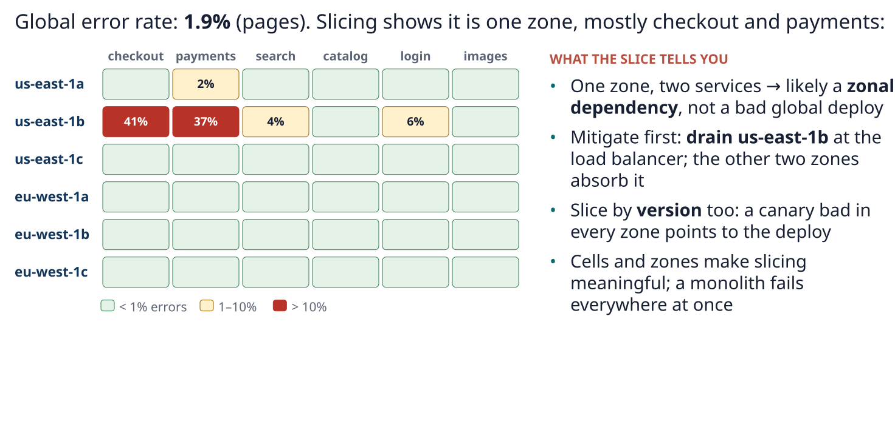

<!--
[~2 min] This is a fictional Atlas Market snapshot. The habit to teach: before forming a theory, slice the symptom by every dimension you have (region, zone, cell, version, client, tenant). The pattern of the slice is usually the diagnosis. Zonal evacuation is a common first mitigation at large cloud users.
-->

---

<!-- _class: dense -->
<!-- _footer: 'Sources: [Cloudflare: Details of the July 2, 2019 outage](https://blog.cloudflare.com/details-of-the-cloudflare-outage-on-july-2-2019/)' -->

# Cloudflare 2019: one regex, every server, 27 minutes

**Problem:** A new WAF managed rule contained a regular expression that backtracked catastrophically. Deployed globally in one step, it drove CPU to 100% on machines serving HTTP traffic worldwide; users saw 502 errors.

**Pattern:** **Global kill switch** to mitigate first, then **staged rollouts** and a regex engine that bounds run time.

**How they did it:**
1. Alerts fired within minutes; the pattern (all locations, CPU pegged, right after a WAF release) pointed at the rule push.
2. Engineers used a **global terminate** of the WAF managed rulesets: traffic recovered while the rule was still unexplained.
3. Root cause found afterwards: `.*(?:.*=.*)` style backtracking in the new rule.
4. Follow-ups: staged rollout for WAF rules like other software, re-enable runaway-CPU protection, and move to a regex engine with linear-time guarantees.
5. Internal tooling that depended on Cloudflare itself slowed responders: ensure out-of-band access.

> **Result:** Outage from **13:42 to 14:09 UTC (~27 min)**; recovery came from a pre-built global off-switch, not from a fix.
>
> **Lesson:** Config is code: stage it. Build the kill switch before you need it, and mitigate before you diagnose.

<!--
[~3 min] Ask: why was this rule deployed globally at once? Because WAF rules were treated as urgent data that must protect customers from new attacks quickly. The trade-off between speed of protection and safety of rollout is real; the fix was to stage even urgent changes.
-->

---

<!-- _class: img -->
<!-- _footer: 'Sources: [SRE book: Managing incidents](https://sre.google/sre-book/managing-incidents/) · [PagerDuty incident response](https://response.pagerduty.com/)' -->

# Organize people with incident command roles

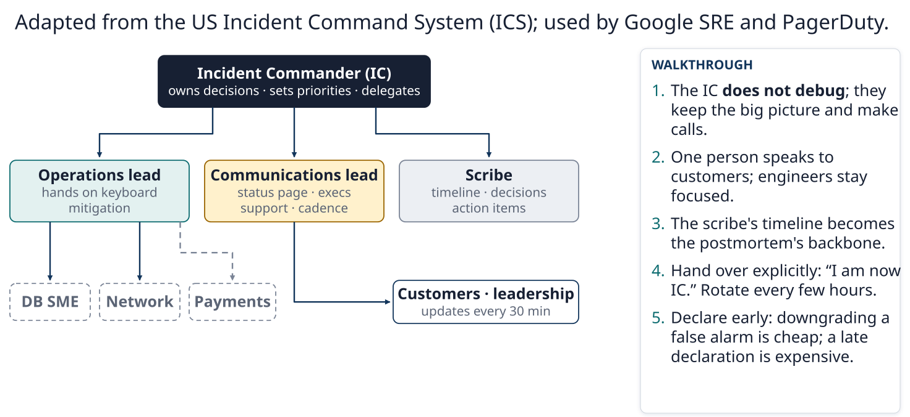

<!--
[~2 min] The SRE book's 'Managing Incidents' chapter describes a disorganized response and then the same incident with clear roles. PagerDuty's open-source response documentation includes role checklists students can adopt directly. In small teams one person may hold several roles, but the IC role should still be explicit.
-->

---

<!-- _class: img -->

# The first 15 minutes of a well-run incident

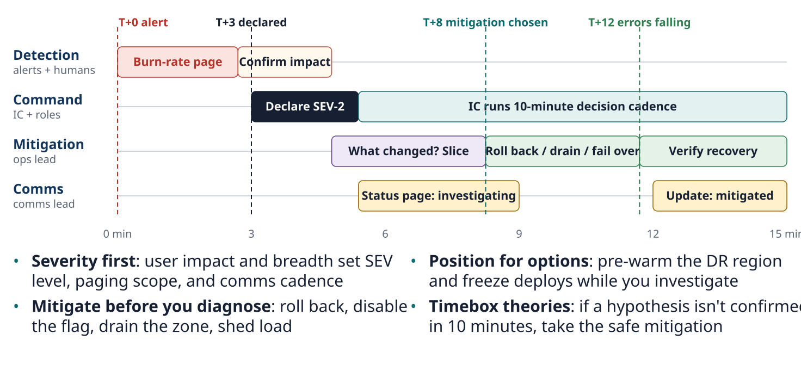

<!--
[~3 min] Walk through the lanes. 'Positioning' means creating options before you need them: scaling up the standby region, freezing deploys, notifying the payment provider, and preparing a status page draft. The IC's job is to make the cheapest reversible move first and keep the expensive irreversible move (a cross-region database failover) ready.
-->

---

# Choose the cheapest, most reversible lever first

| Lever | Use when | Typical time | Risk / cost |
|---|---|---|---|
| Roll back the deploy or config | Impact began right after a change | Minutes | Low, if rollback is tested and the change was backward compatible |
| Disable a feature flag / kill switch | A new feature or rule is implicated | Seconds | Feature unavailable; needs flags built in advance |
| Drain a zone, cell, or host | Impact is localized (slicing shows it) | Minutes | Remaining capacity must absorb the load |
| Shed load / rate-limit / degrade | Overload, retry storms, slow dependency | Minutes | Some users get errors or reduced features (read-only mode) |
| Scale out | Saturation from real demand | Minutes to hours | Doesn't help a bug; can overload a shared dependency |
| Regional failover | Region or primary DB is unrecoverable for longer than your RTO | Minutes to hours | Data loss within RPO; split-brain risk; **failback later** |

<!--
[~2 min] This table is ordered roughly by reversibility. Regional database failover is at the bottom: it is powerful, but it can lose writes and it commits you to a failback later. That is the bridge to Module 5.
-->

---

<!-- _footer: 'Sources: [Azure DevOps postmortem (2018)](https://devblogs.microsoft.com/devopsservice/postmortem-vsts-4-september-2018/) · [GitHub Oct 21 analysis](https://github.blog/news-insights/company-news/oct21-post-incident-analysis/)' -->

# Fail over to the backup region, or repair in place?

| Fail over now | Repair in place |
|---|---|
| Restores service within the RTO if the standby is healthy and warm | No data loss, no divergence, no failback |
| Loses writes inside the replication lag window (RPO > 0 for async) | Outage lasts as long as the repair |
| Requires fencing the old primary to avoid **split brain** | **Azure DevOps, Sept 2018**: a storm and cooling failure took down South Central US; the team chose **not** to fail over to avoid losing data and waited ~21 hours |
| Commits you to a later failback, with its own risk | **GitHub, Oct 2018**: automation failed over during a 43-second partition; both sites then held unreplicated writes: 24 h of degradation |
| Good fit: region gone for hours; lag small; stateless tiers | Good fit: expected recovery < RTO; RPO must be 0 |

**Lesson:** Decide the policy **before** the incident: per data class, what outage length justifies how much data loss?

<!--
[~2 min] Microsoft's Azure DevOps postmortem explains the team waited for the region rather than fail over, because asynchronous geo-replication meant failing over would lose recent data. They later said they would offer customers the choice. GitHub's case is the opposite failure: failing over too eagerly. We study it in detail in Module 5.
-->

---

<!-- _class: dense -->
<!-- _footer: 'Sources: [Meta: More details about the October 4 outage](https://engineering.fb.com/2021/10/05/networking-traffic/outage-details/)' -->

# Facebook 2021: when the tools you need are behind the outage

**Problem:** During routine maintenance, a command meant to assess backbone capacity disconnected all of Facebook's data centers from each other. An audit tool that should have stopped the command had a bug.

**Pattern:** **Out-of-band access and careful, staged recovery**: the hard part was getting back in, then not tipping over on the way up.

**How they did it:**
1. DNS servers, unable to reach the data centers, **withdrew their BGP routes** as designed: Facebook vanished from the internet.
2. Remote tools, internal DNS, and access systems depended on the same network, so engineers had to work on-site.
3. Physical security (by design hard to bypass) slowed hands-on access to the routers.
4. Bringing everything back at once risked power surges and cache overload; services were restored gradually.
5. Previous **“storm” drills** for large-scale outages had rehearsed the staged return of traffic.

> **Result:** Facebook, Instagram, and WhatsApp were unavailable for **about six hours** (as widely reported).
>
> **Lesson:** Keep an out-of-band path to production, and rehearse bringing load back slowly. Recovery is its own incident.

<!--
[~2 min] The lesson for web developers: your status page, your chat, your VPN, and your deploy tool all need a path that does not depend on the thing that is broken. And the 'staged restore' theme returns in Module 5 when we look at Roblox and AWS recovery surges.
-->

---

<!-- _class: section kick -->

BREAK · 10 MINUTES

# Break

### Next: the region is gone. Fail over, rehydrate, and, the hard part, fail back.

- Think about it: when did your team last restore a production backup on purpose?
- How long did it take, and who knew how to do it?

<!--
[~10 min] Ten-minute break. Module 5 is the longest module and ends with the tabletop exercise.
-->

---

<!-- _class: section kick -->

MODULE 5 · 40 MINUTES

# Recover and fail back

### How do we restore service from backup or DR, rebuild everything that depends on the data, and return to the primary safely?

- RPO and RTO per data class; DR strategies and what they cost
- Failover, split brain, and fencing; reconciling divergent writes
- Rehydrating derived data: caches, search, streams, objects
- Failback as a planned switchover · Tabletop exercise (15 min)

<!--
[~1 min] Most teams practice failover occasionally and failback almost never. This module treats the whole cycle: fail over, run on DR, rebuild the primary, switch back.
-->

---

<!-- _class: img -->

# RPO and RTO on one timeline

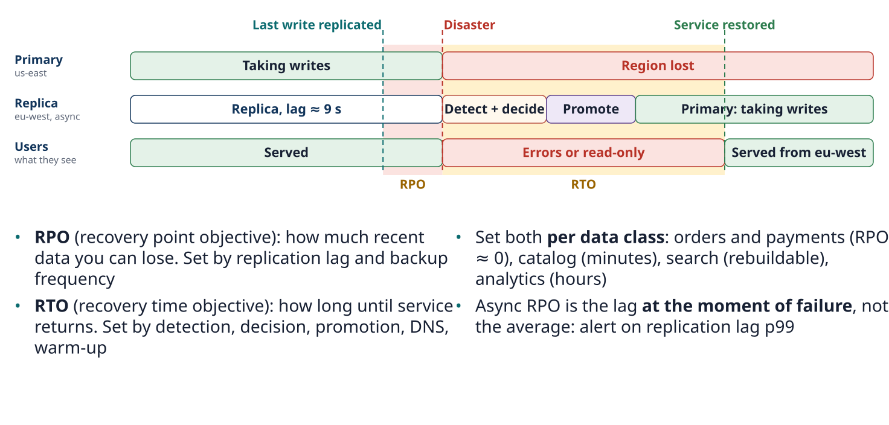

<!--
[~1 min] The red band is data that existed only in the failed region. The amber band is downtime. Note that detection and the human decision often dominate RTO, not the technical promotion.
-->

---

<!-- _footer: 'Sources: [AWS: Disaster recovery options in the cloud](https://docs.aws.amazon.com/whitepapers/latest/disaster-recovery-workloads-on-aws/disaster-recovery-options-in-the-cloud.html)' -->

# Four DR strategies: cost buys a smaller RPO and RTO

| Strategy | How it works | RPO / RTO (typical) | Cost | Atlas Market fit |
|---|---|---|---|---|
| Backup & restore | Back up data and infrastructure-as-code to another region; restore and redeploy after the disaster | Hours | $ | Analytics warehouse, logs, internal tools |
| Pilot light | Data replicated live; core infrastructure defined but scaled to zero; scale up on failover | Tens of minutes | $$ | Catalog admin, merchant reporting |
| Warm standby | Scaled-down but fully working copy runs all the time; scale out on failover | Minutes | $$$ | Checkout and orders DB (async replica) |
| Multi-site active/active | Full capacity in two or more regions serving traffic; data replicated or partitioned | Near real time | $$$$ | Login, catalog reads, edge, CDN |

**AWS guidance:** During failover, rely on **data-plane** actions (pre-provisioned capacity, health-checked DNS) rather than control-plane APIs that the same event may have impaired.

<!--
[~2 min] The RPO/RTO ranges are the AWS whitepaper's. Mixing strategies per service is normal: not every system deserves active/active. The data-plane point matters: in large regional events, control-plane APIs (launching instances, changing configs) are often the first thing to be throttled or impaired.
-->

---

<!-- _footer: 'Sources: [GitLab postmortem (2017)](https://about.gitlab.com/blog/postmortem-of-database-outage-of-january-31/) · [OVH fire coverage](https://www.datacenterknowledge.com/outages/ovh-founder-data-center-fire-incident-shows-all-backup-should-be-free)' -->

# Backups are not DR until you have restored them

- **GitLab, January 2017** — An engineer deleted ~300 GB of production data on the wrong host. Several backup mechanisms turned out not to be working. Recovery used a ~6-hour-old staging snapshot; copying it back took ~18 hours.
- **OVHcloud, March 2021** — A fire destroyed the SBG2 data center in Strasbourg. Customers whose only backups lived in the same site lost their data permanently.
- **Replication is not backup** — A bad migration, `DROP TABLE`, or ransomware replicates to every region in milliseconds. Keep point-in-time recovery and delayed copies.
- **3-2-1, plus immutable** — Three copies, two media, one off-site, plus one **immutable** copy (object lock, separate account). If prod credentials can delete it, it is not a backup.
- **A backup is a hypothesis** — Restore automatically every day into a scratch environment; check row counts and checksums; record how long it took.
- **Restore granularity** — Can you restore one table, one tenant, one object? A whole-database restore overwrites good data written since. (Atlassian, later.)

<!--
[~1 min] GitLab's postmortem is remarkably candid and worth assigning as reading; the team also live-streamed the recovery. About 5,000 projects, 5,000 comments and 700 new user accounts were affected by the six-hour data loss window.
-->

---

<!-- _class: img -->

# Your restore time is bounded by bytes ÷ throughput

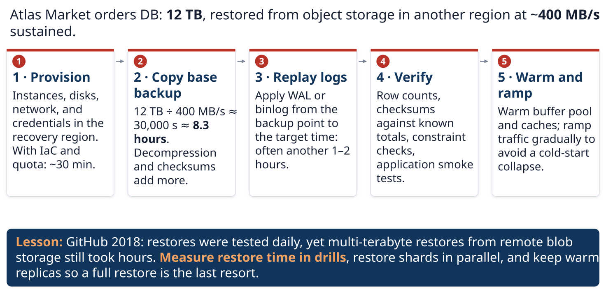

<!--
[~1 min] Do the arithmetic with the class: 12 × 10^12 bytes / 4 × 10^8 bytes per second = 30,000 seconds. If your RTO is one hour, a restore from backup cannot be your DR plan for this database. Sharding helps because shards restore in parallel.
-->

---

<!-- _class: img -->

# Fail over, run on DR, rebuild, then fail back

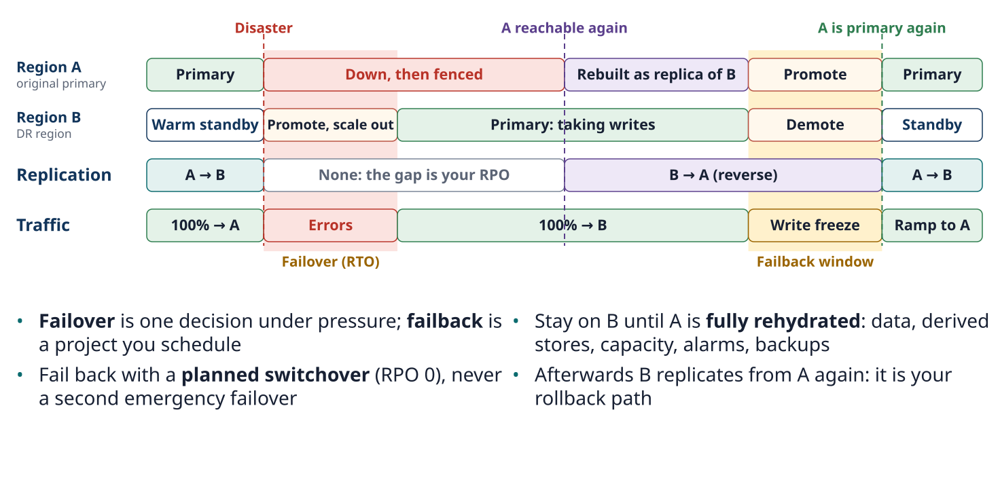

<!--
[~2 min] This is the map for the rest of the module. The 'reverse replication' lane is the key idea: you rebuild the original primary as a replica of the DR region, let it catch up while B serves traffic, and only then switch back during a short, planned write freeze.
-->

---

<!-- _class: img -->
<!-- _footer: 'Sources: [Kleppmann: fencing tokens](https://martin.kleppmann.com/2016/02/08/how-to-do-distributed-locking.html)' -->

# Split brain: why the old primary must be fenced

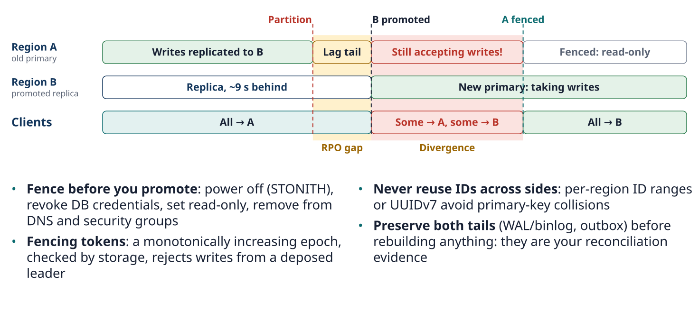

<!--
[~2 min] Two kinds of lost or conflicting data: the amber RPO gap (written to A, never reached B) and the red divergence (written to A after B was promoted). Fencing removes the red band; only synchronous replication removes the amber one.
-->

---

<!-- _class: dense -->
<!-- _footer: 'Sources: [GitHub: October 21 post-incident analysis](https://github.blog/news-insights/company-news/oct21-post-incident-analysis/)' -->

# GitHub 2018: fail forward, sync, then fall back

**Problem:** A 43-second network partition let Orchestrator promote US West Coast database primaries. Apps wrote to the West for ~40 minutes, while the East held seconds of writes never replicated West. Neither site could simply become primary.

**Pattern:** **Fail forward, synchronize, fall back, then drain backlogs**, choosing data integrity over time to recovery.

**How they did it:**
1. Locked deploys; paused webhooks and Pages builds so no new work piled onto inconsistent data.
2. Restored East Coast replicas from backups (every 4 h, in remote cloud blob storage); transfer, decompress, and prepare took hours.
3. Replicated West → East. Catch-up followed a **power-decay curve**, not a line, and slowed at daily peak; extra read replicas helped.
4. Failed back to the East Coast topology once in sync, then processed **5M+ webhook events and 80K Pages builds**; ~200K payloads expired on a TTL.
5. Captured East binlogs of unreplicated writes (954 on one busy cluster) for reconciliation.

> **Result:** **24 h 11 min** of degraded service; no user data lost; a few seconds of writes reconciled manually.
>
> **Lesson:** Don't let automation promote across regions your app can't run from. Restore, catch-up, and backlog dominate recovery time.

<!--
[~2 min] This is the canonical public failback story. Emphasize three things. One: estimates were wrong because replica catch-up is not linear when write load rises during the day. Two: the backlog of webhooks was itself a hazard, both to partners and because of a TTL that silently dropped payloads. Three: GitHub kept the status red until backlogs were drained, which is good practice for honest communication.
-->

---

# Reconcile divergent writes with per-data-class rules

| Data class | Example | Strategy | Who |
|---|---|---|---|
| Append-only facts | New orders, comments | Replay the missing tail into the new primary with idempotency keys; remap colliding IDs | Automated |
| External system of record | Card captured by the PSP, email sent | Reconcile against the provider's ledger; never charge twice; refund or fulfil | Finance + automation |
| Mutable records | Address or profile edits | Field-level last-writer-wins with a trusted clock, or keep both and ask the user | Automated + user |
| Counters and inventory | Stock levels, balances | Do not merge numbers: recompute from the event ledger of both sides | Automated |
| Uniqueness | Usernames, coupon redemptions | Detect duplicates, apply a business rule (first wins), contact the other party | Human review |
| Deletes | Account closure, GDPR erasure | Re-apply deletes after the merge; tombstones must win | Compliance |

**Principle:** Write these rules **before** the incident. Reconciliation is a product decision, not just a database operation.

<!--
[~2 min] Ask the class which row is hardest. Usually it is the external system of record: the payment provider captured money for an order your database no longer has. The PSP's records become the source of truth for rebuilding those orders.
-->

---

<!-- _class: img -->
<!-- _footer: 'Sources: [Aurora Global Database: DR, switchover, failback](https://docs.aws.amazon.com/AmazonRDS/latest/AuroraUserGuide/aurora-global-database-disaster-recovery.html)' -->

# Failback: rebuild A from B, then a planned switchover

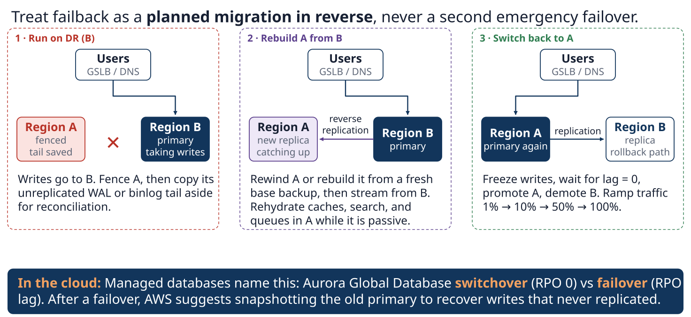

<!--
[~2 min] Three panels, left to right, map to the last three phases of the lifecycle timeline. The key safety properties: A never accepts writes while B is primary (fencing), A is rebuilt from B rather than trusted as-is (it may contain divergent writes), and the switch back happens at lag zero, so RPO is zero for the planned move.
-->

---

<!-- _class: img -->
<!-- _footer: 'Sources: [PostgreSQL docs: pg_rewind](https://www.postgresql.org/docs/current/app-pgrewind.html)' -->

# Failback runbook sketch: PostgreSQL

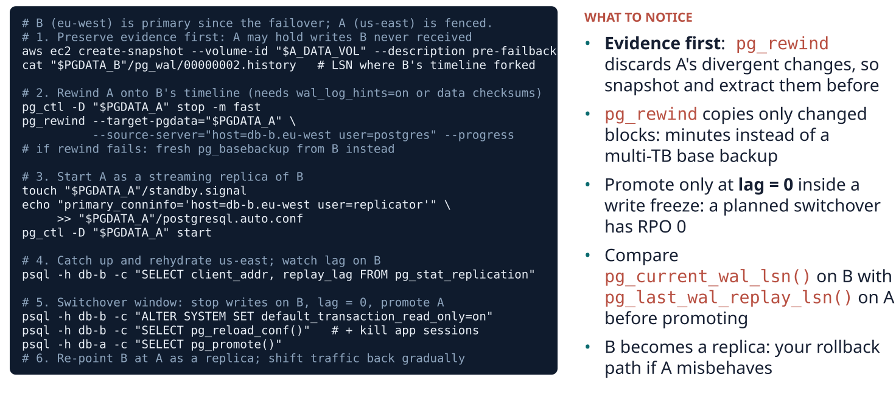

<!--
[~2 min] A sketch, not a copy-paste runbook: real runbooks add pre-checks, owner sign-off, timing targets, and rollback triggers for every step. Managed services (RDS, Aurora, Cloud SQL, Azure SQL) wrap these steps in a 'switchover' API, but the same ordering applies: evidence, rebuild, catch up, freeze, promote, re-point.
-->

---

<!-- _class: img -->

# Planned region move: the same procedure, rehearsed

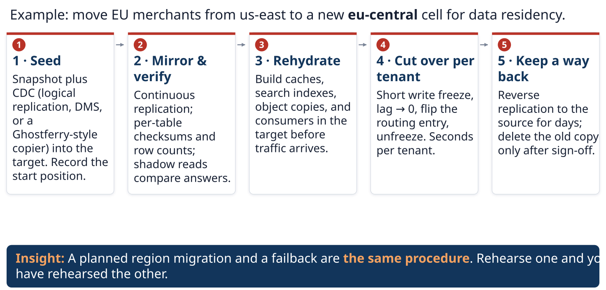

<!--
[~1 min] This connects back to Module 3. Shopify's pod moves and Ghostferry use exactly this shape: copy, tail the binlog, verify, brief per-tenant cutover. Doing small planned moves often keeps the failback muscle exercised.
-->

---

<!-- _footer: 'Sources: [Kafka KIP-382: MirrorMaker 2](https://cwiki.apache.org/confluence/display/KAFKA/KIP-382%3A+MirrorMaker+2.0) · [S3 Batch Replication](https://docs.aws.amazon.com/AmazonS3/latest/userguide/s3-batch-replication-batch.html)' -->

# Rehydrate derived data, not just the database

| Store | State after failover or failback | Technique |
|---|---|---|
| Caches (Redis, Memcached) | Cold, or holding values from the diverged side | Flush or bump the key version; warm from top-N keys; leases against stampedes (Facebook warms a cold cluster from a warm one) |
| Search indexes | Missing or extra documents vs. the reconciled DB | Rebuild from the DB or CDC into a new index, then swap the alias; reindex the divergence window |
| Event streams (Kafka) | Consumer offsets differ between clusters | MirrorMaker 2 checkpoints translate consumer offsets; consumers must be idempotent and tolerate replays |
| Object storage (S3, GCS) | Objects written in B are missing in A | Live replication for new objects plus S3 Batch Replication for existing ones; reconcile with inventory reports |
| Analytics and warehouse | Gap or duplicates for the outage window | Re-run pipelines for the window from the reconciled source; dedupe by event ID |
| DNS, sessions, tokens | Clients pinned to B; sessions issued in B | Lower DNS TTLs a day before failback; accept sessions in both regions; share signing keys |

<!--
[~2 min] Every derived store from Module 1's outbox/CDC diagram appears here. If you designed derived stores to be rebuildable from the system of record, rehydration is a batch job. If not, it is an incident of its own.
-->

---

<!-- _footer: 'Sources: [AWS: October 2025 us-east-1 summary](https://aws.amazon.com/message/101925/) · [Roblox: return to service](https://about.roblox.com/newsroom/2022/01/roblox-return-to-service-10-28-10-31-2021)' -->

# Coming back up is its own incident

- **AWS us-east-1, October 2025** — After the DynamoDB DNS problem was fixed, EC2's droplet workflow manager had so many leases to re-establish that it entered **congestive collapse**. Engineers throttled work and restarted hosts to recover.
- **Roblox, October 2021** — After 73 hours down, players were let back in gradually, in steps of about **10%** via DNS steering, while the team watched Consul and the caches at each step.
- **Facebook, October 2021** — Power draw and cold caches could not take full load at once; services returned in stages, as rehearsed in earlier storm drills.
- **Patterns that prevent a second outage** — Ramp traffic in steps with hold points; Warm caches before shifting reads; Capped, jittered retries and circuit breakers; Admission control and load shedding at the edge; Pause batch jobs and backfills until stable

<!--
[~1 min] The thundering herd after recovery is predictable: every client retries, every cache is cold, every queue has a backlog. Plan the ramp as carefully as the failover.
-->

---

<!-- _footer: 'Sources: [Atlassian: post-incident review, April 2022](https://www.atlassian.com/blog/how-we-build/post-incident-review-april-2022-outage)' -->

# Atlassian 2022: restore some tenants, not the whole DB

**Problem:** A maintenance script meant to delete a legacy app's data was given **site IDs instead of app IDs**, and permanently deleted 883 customer sites belonging to 775 customers.

**Pattern:** **Tenant-granular restore**: point-in-time recovery of a subset of tenants inside live, multi-tenant databases.

**How they did it:**
1. Backups with point-in-time recovery existed, but rolling a shared database back would destroy other customers' newer data.
2. Restoring one site meant recreating it and rehydrating data across many services and stores, and the process was largely manual.
3. Engineers automated the restore steps during the incident and restored sites in parallel batches.
4. Every site was restored by April 18, and no customer lost more than five minutes of data.

> **Result:** Some customers were down for up to **14 days**; data recovered with at most 5 minutes of loss.
>
> **Lesson:** Rehearse restoring a single tenant, not just the cluster. Prefer soft deletes and validate the type of IDs a destructive script receives.

<!--
[~2 min] Contrast with GitHub: there, the whole cluster needed rebuilding. Here, the backups were fine, but the restore unit (whole database) did not match the failure unit (some tenants). Design the restore unit to match how you partition customers.
-->

---

# Rehydration and failback checklist

- **Before the switchover** — A caught up: lag < 1 s, sustained; Divergent writes reconciled or quarantined; Caches, search, objects rebuilt in A; A scaled to peak plus headroom; Alarms, dashboards, backups point at A; DNS TTLs lowered 24 h ahead; Go/no-go owner and rollback trigger agreed
- **During** — Announce the window; freeze deploys; Write freeze; lag = 0; checksums match; Promote A; demote B; flip writers; Ramp reads 1 → 10 → 50 → 100%; Golden signals checked at each step
- **After** — B replicating from A (rollback path); Backups running and test-restored in A; Backlogs drained with rate limits; Status page updated; incident closed; Actual RPO/RTO recorded vs targets; Review scheduled

<!--
[~1 min] Give students this slide as a takeaway. Every item maps to a failure someone has published.
-->

---

# Tabletop: Atlas Market loses us-east on Black Friday

> **Scenario:** 11:40 UTC, near peak. us-east is cut off from the internet and from eu-west. The orders replica in eu-west is **9 s behind**: about **1,800 orders** placed in us-east have not replicated, and the PSP has already **captured** their payments. Kafka mirroring is 2 minutes behind. The cloud provider gives no ETA.

1. Do you fail over now or wait? Who decides, using which numbers?
2. How do you fence us-east so it cannot accept writes if it returns mid-failover?
3. What happens to the ~1,800 orders: customers, payments, inventory, emails?
4. What must be rehydrated in eu-west before it takes 100% of traffic?
5. us-east returns three hours later. Write the first five steps of your failback.

**How to run it:** Teams of 4–5: IC, ops lead, comms lead, scribe · 8 minutes to decide, 4 minutes to report · Scribe records decisions and their triggers

<!--
[~12 min] Facilitation tip: after 4 minutes, inject a complication: us-east briefly comes back and some clients reconnect to it. Teams that fenced it early will be fine; others discover split brain.
-->

---

# Tabletop debrief: what strong answers include

- **Decide by policy** — Fail over if the outage will exceed the RTO budget and lag is within the agreed RPO. The IC decides with the data owner.
- **Fence first** — Revoke us-east DB credentials, pull it from GSLB, set it read-only, and bump the fencing epoch in the router.
- **The 1,800 orders** — The PSP is the source of truth. Rebuild orders from captures plus the us-east tail; never charge twice; tell affected customers.
- **Rehydrate before 100%** — Size eu-west search and caches for global traffic; recompute inventory from events; translate Kafka offsets.
- **Failback plan** — Snapshot us-east → rewind or rebuild as a replica → rehydrate → freeze → lag 0 → promote → ramp.
- **Communicate** — Status page within 10 minutes, a PSP contact, a cadence for leadership, and emails for affected orders.

<!--
[~3 min] Ask one team to read their failback steps aloud and compare with the checklist slide.
-->

---

<!-- _class: section kick -->

MODULE 6 · 10 MINUTES

# Learn: operational review

### How do incidents become durable improvements instead of recurring surprises?

- Blameless postmortems with tracked corrective actions
- Weekly operational reviews of dashboards and trends
- Metrics that help, and the ones that mislead
- Practice: game days, chaos experiments, DR and failback drills

<!--
[~1 min] The last module closes the loop: detection and recovery matter only if the system and the team get better afterwards.
-->

---

<!-- _class: img -->
<!-- _footer: 'Sources: [AWS: Creating a Correction of Errors document](https://aws.amazon.com/blogs/mt/creating-a-correction-of-errors-document/) · [Etsy: Blameless postmortems (archived)](https://web.archive.org/web/20231230191519/https://www.etsy.com/codeascraft/blameless-postmortems/) · [SRE book: Postmortem culture](https://sre.google/sre-book/postmortem-culture/)' -->

# Blameless postmortems that change the system

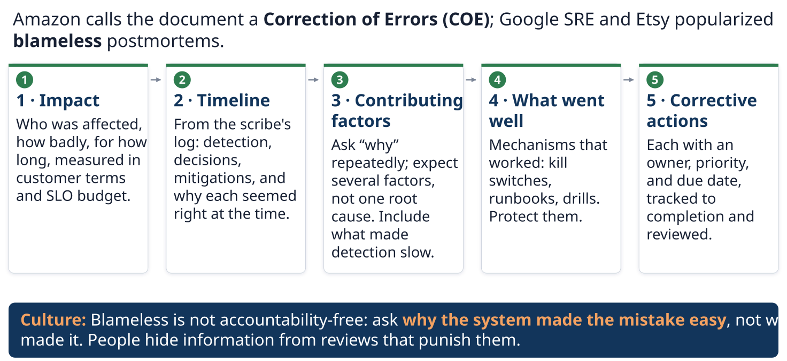

<!--
[~2 min] A good test: would the engineer who ran the command in the GitLab or Atlassian incidents feel safe writing the timeline honestly? If not, you will get a sanitized document and learn nothing.
-->

---

<!-- _footer: 'Sources: [AWS Open Source Blog: The Wheel](https://aws.amazon.com/blogs/opensource/the-wheel/)' -->

# Weekly ops review: inspect before it breaks

- **AWS's weekly operations meeting**: a two-hour review with senior leaders, service managers, and engineers, held for over a decade
- **The Wheel** picks which team presents
   - A software “wheel of fortune” selects a service at random each slot
   - That team walks through its operational dashboard and answers questions
   - Because any team can be chosen, every team keeps dashboards current
- Other slots: deep dives on recent events and open COE actions
- **Atlas Market version**: 45 minutes weekly; SLO burn by service, top alerts, open actions, one random dashboard

> **What to review each week** — SLO attainment and error-budget burn Pages per on-call shift and noisy alerts Changes that caused incidents Overdue corrective actions Replication lag and backup-restore results Capacity headroom per region

<!--
[~2 min] The randomness is the mechanism: it creates a standing incentive to keep dashboards meaningful. The AWS Ops Wheel is open source on GitHub. For a small team, rotate who presents and always include replication lag and restore-test results, the DR signals that silently decay.
-->

---

<!-- _footer: 'Sources: [InfoQ: the VOID and incident metrics](https://www.infoq.com/articles/incident-metrics-void/)' -->

# Reliability metrics: what helps and what misleads

| Track these | Use with care |
|---|---|
| **SLO attainment** and error-budget burn per service | **MTTR averages**: incident durations are heavily skewed, so a mean hides more than it shows (VOID report) |
| **Time to detect** and time to mitigate, as distributions | **Incident counts** as targets: teams stop declaring incidents |
| Incidents by **trigger**: deploy, config, capacity, dependency, data | **“Zero incidents”** goals: punish reporting, not failure |
| **Corrective-action completion** rate and age | **Root cause = human error**: a stopping point, not a cause |
| **Restore and failover drill** results: actual RPO and RTO vs targets |  |

**Rule of thumb:** Report percentiles and individual stories; read the long incidents, not the average.

<!--
[~2 min] The Verica Open Incident Database analyzed thousands of public incidents and found duration distributions too skewed for MTTR to be a meaningful measure of reliability or improvement.
-->

---

<!-- _footer: 'Sources: [Netflix: Chaos engineering upgraded](https://netflixtechblog.com/chaos-engineering-upgraded-878d341f15fa) · [ACM Queue: Weathering the unexpected (DiRT)](https://queue.acm.org/detail.cfm?id=2371516)' -->

# Practice failure on purpose

- **Chaos engineering · Netflix** — Chaos Monkey terminates instances in production; **Chaos Kong** exercises evacuating an entire AWS region, so a real regional failure is a practiced move.
- **DiRT · Google** — Disaster Recovery Testing: planned, company-wide exercises that take down systems and people's access to find hidden dependencies before a real disaster does.
- **Game days and tabletops** — Rehearse roles and decisions like today's exercise; inject faults with tools such as AWS Fault Injection Service in a staging or production cell.
- **Drill the whole cycle** — Quarterly: restore from backup, fail over a cell, **and fail back**. Time each step and feed the numbers into RTO targets and the weekly review.

<!--
[~2 min] Start small: a restore test in staging every day, a tabletop every quarter, one real failover and failback of a non-critical cell before you try it with the orders database.
-->

---

# What to take back to your team

| Module | Key idea | Do this next week |
|---|---|---|
| 1 · Store | Choose consistency per data class; propagate change with an outbox and CDC | List your data classes with system of record, RPO, and rebuild path |
| 2 · Query | Optimize total time and p99; fan-out amplifies tail latency | Run EXPLAIN (ANALYZE, BUFFERS) on your top three queries by total time |
| 3 · Change | Expand/contract, shadow verification, and a rollback path for every migration | Add lock and statement timeouts to your migration tooling |
| 4 · Detect | Page on SLO burn and business metrics; slice to localize; IC roles | Write one multiwindow burn-rate alert and a role checklist |
| 5 · Recover | Fence, reconcile, rehydrate derived data, fail back with a planned switchover | Time a full restore of your largest database; write the failback runbook |
| 6 · Learn | Blameless reviews with tracked actions; weekly ops review; drills | Schedule a tabletop and a restore drill |

<!--
[~1 min] Close by asking each student to pick one 'next week' action for a system they work on.
-->

---

<!-- _class: refs -->

# References (1 of 3)

- [Spanner (OSDI 2012)](https://research.google/pubs/spanner-googles-globally-distributed-database-2/) · research.google
- [DynamoDB global tables](https://docs.aws.amazon.com/amazondynamodb/latest/developerguide/V2globaltables_HowItWorks.html) · docs.aws.amazon.com
- [Aurora Global Database DR](https://docs.aws.amazon.com/AmazonRDS/latest/AuroraUserGuide/aurora-global-database-disaster-recovery.html) · docs.aws.amazon.com
- [Slack + Vitess](https://slack.engineering/scaling-datastores-at-slack-with-vitess/) · slack.engineering
- [S3 Replication Time Control](https://docs.aws.amazon.com/AmazonS3/latest/userguide/replication-time-control.html) · docs.aws.amazon.com
- [S3 strong consistency (2020)](https://aws.amazon.com/blogs/aws/amazon-s3-update-strong-read-after-write-consistency/) · aws.amazon.com
- [Cloudflare Workers KV](https://developers.cloudflare.com/kv/concepts/how-kv-works/) · developers.cloudflare.com
- [Dynamo (SOSP 2007)](https://www.allthingsdistributed.com/files/amazon-dynamo-sosp2007.pdf) · allthingsdistributed.com
- [Scaling Memcache at Facebook (NSDI 2013)](https://www.usenix.org/system/files/conference/nsdi13/nsdi13-final170.pdf) · usenix.org
- [Debezium outbox router](https://debezium.io/documentation/reference/stable/transformations/outbox-event-router.html) · debezium.io
- [Netflix DBLog (arXiv)](https://arxiv.org/abs/2010.12597) · arxiv.org
- [Shopify pods](https://shopify.engineering/a-pods-architecture-to-allow-shopify-to-scale) · shopify.engineering
- [Shopify shard balancing](https://shopify.engineering/mysql-database-shard-balancing-terabyte-scale) · shopify.engineering
- [PostgreSQL pg_stat_statements](https://www.postgresql.org/docs/current/pgstatstatements.html) · postgresql.org
- [PostgreSQL EXPLAIN](https://www.postgresql.org/docs/current/using-explain.html) · postgresql.org
- [CREATE INDEX CONCURRENTLY](https://www.postgresql.org/docs/current/sql-createindex.html#SQL-CREATEINDEX-CONCURRENTLY) · postgresql.org
- [Slack: Evolving API pagination](https://slack.engineering/evolving-api-pagination-at-slack/) · slack.engineering
- [Use The Index, Luke: no offset](https://use-the-index-luke.com/no-offset) · use-the-index-luke.com
- [Discord: storing trillions of messages](https://discord.com/blog/how-discord-stores-trillions-of-messages) · discord.com
- [The Tail at Scale (CACM 2013)](https://research.google/pubs/the-tail-at-scale/) · research.google

<!--
Sources cited on the slides, in order of first appearance.
-->

---

<!-- _class: refs -->

# References (2 of 3)

- [github/gh-ost](https://github.com/github/gh-ost) · github.com
- [PostgreSQL ALTER TABLE](https://www.postgresql.org/docs/current/sql-altertable.html) · postgresql.org
- [PostgreSQL explicit locking](https://www.postgresql.org/docs/current/explicit-locking.html) · postgresql.org
- [Stripe: Online migrations at scale](https://stripe.com/blog/online-migrations) · stripe.com
- [Notion: Sharding Postgres](https://www.notion.com/blog/sharding-postgres-at-notion) · notion.com
- [Notion: The great re-shard](https://www.notion.com/blog/the-great-re-shard) · notion.com
- [GitHub: Upgrading GitHub.com to MySQL 8.0](https://github.blog/engineering/infrastructure/upgrading-github-com-to-mysql-8-0/) · github.blog
- [Shopify/ghostferry](https://github.com/Shopify/ghostferry) · github.com
- [Google SRE book: Introduction](https://sre.google/sre-book/introduction/) · sre.google
- [SRE book: Monitoring distributed systems](https://sre.google/sre-book/monitoring-distributed-systems/) · sre.google
- [Brendan Gregg: USE method](https://www.brendangregg.com/usemethod.html) · brendangregg.com
- [Netflix: SPS, the pulse of streaming](https://netflixtechblog.com/sps-the-pulse-of-netflix-streaming-ae4db0e05f8a) · netflixtechblog.com
- [SRE workbook: Alerting on SLOs](https://sre.google/workbook/alerting-on-slos/) · sre.google
- [Cloudflare: Details of the July 2, 2019 outage](https://blog.cloudflare.com/details-of-the-cloudflare-outage-on-july-2-2019/) · blog.cloudflare.com
- [SRE book: Managing incidents](https://sre.google/sre-book/managing-incidents/) · sre.google
- [PagerDuty incident response](https://response.pagerduty.com/) · response.pagerduty.com
- [Azure DevOps postmortem (2018)](https://devblogs.microsoft.com/devopsservice/postmortem-vsts-4-september-2018/) · devblogs.microsoft.com
- [GitHub Oct 21 analysis](https://github.blog/news-insights/company-news/oct21-post-incident-analysis/) · github.blog
- [Meta: More details about the October 4 outage](https://engineering.fb.com/2021/10/05/networking-traffic/outage-details/) · engineering.fb.com
- [AWS: Disaster recovery options in the cloud](https://docs.aws.amazon.com/whitepapers/latest/disaster-recovery-workloads-on-aws/disaster-recovery-options-in-the-cloud.html) · docs.aws.amazon.com

<!--
Sources cited on the slides, in order of first appearance.
-->

---

<!-- _class: refs -->

# References (3 of 3)

- [GitLab postmortem (2017)](https://about.gitlab.com/blog/postmortem-of-database-outage-of-january-31/) · about.gitlab.com
- [OVH fire coverage](https://www.datacenterknowledge.com/outages/ovh-founder-data-center-fire-incident-shows-all-backup-should-be-free) · datacenterknowledge.com
- [Kleppmann: fencing tokens](https://martin.kleppmann.com/2016/02/08/how-to-do-distributed-locking.html) · martin.kleppmann.com
- [PostgreSQL docs: pg_rewind](https://www.postgresql.org/docs/current/app-pgrewind.html) · postgresql.org
- [Kafka KIP-382: MirrorMaker 2](https://cwiki.apache.org/confluence/display/KAFKA/KIP-382%3A+MirrorMaker+2.0) · cwiki.apache.org
- [S3 Batch Replication](https://docs.aws.amazon.com/AmazonS3/latest/userguide/s3-batch-replication-batch.html) · docs.aws.amazon.com
- [AWS: October 2025 us-east-1 summary](https://aws.amazon.com/message/101925/) · aws.amazon.com
- [Roblox: return to service](https://about.roblox.com/newsroom/2022/01/roblox-return-to-service-10-28-10-31-2021) · about.roblox.com
- [Atlassian: post-incident review, April 2022](https://www.atlassian.com/blog/how-we-build/post-incident-review-april-2022-outage) · atlassian.com
- [AWS: Creating a Correction of Errors document](https://aws.amazon.com/blogs/mt/creating-a-correction-of-errors-document/) · aws.amazon.com
- [Etsy: Blameless postmortems (archived)](https://web.archive.org/web/20231230191519/https://www.etsy.com/codeascraft/blameless-postmortems/) · web.archive.org
- [SRE book: Postmortem culture](https://sre.google/sre-book/postmortem-culture/) · sre.google
- [AWS Open Source Blog: The Wheel](https://aws.amazon.com/blogs/opensource/the-wheel/) · aws.amazon.com
- [InfoQ: the VOID and incident metrics](https://www.infoq.com/articles/incident-metrics-void/) · infoq.com
- [Netflix: Chaos engineering upgraded](https://netflixtechblog.com/chaos-engineering-upgraded-878d341f15fa) · netflixtechblog.com
- [ACM Queue: Weathering the unexpected (DiRT)](https://queue.acm.org/detail.cfm?id=2371516) · queue.acm.org

<!--
Sources cited on the slides, in order of first appearance.
-->
